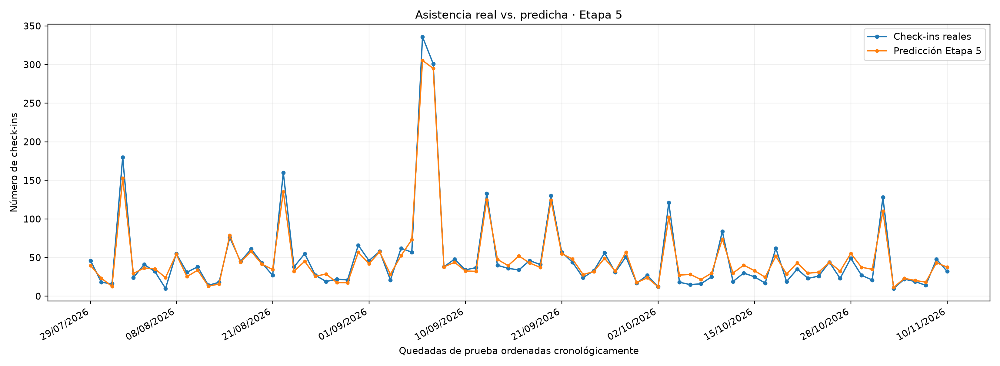
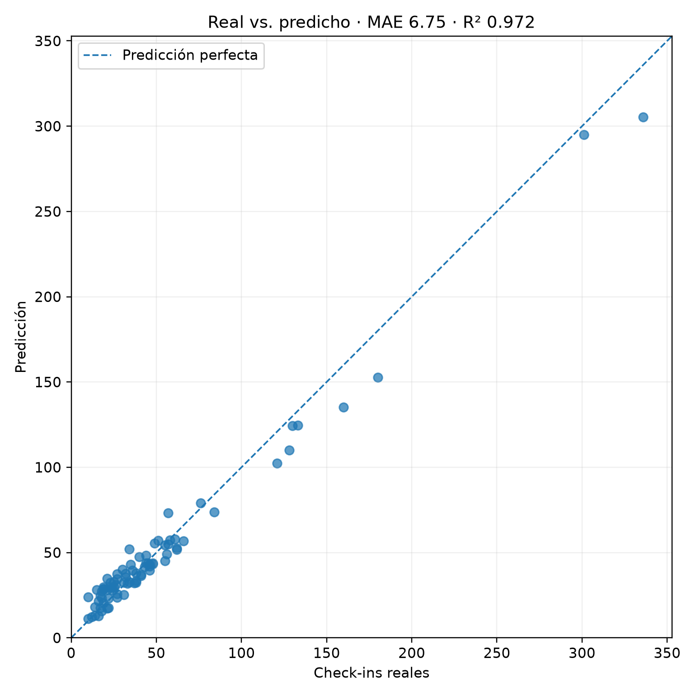
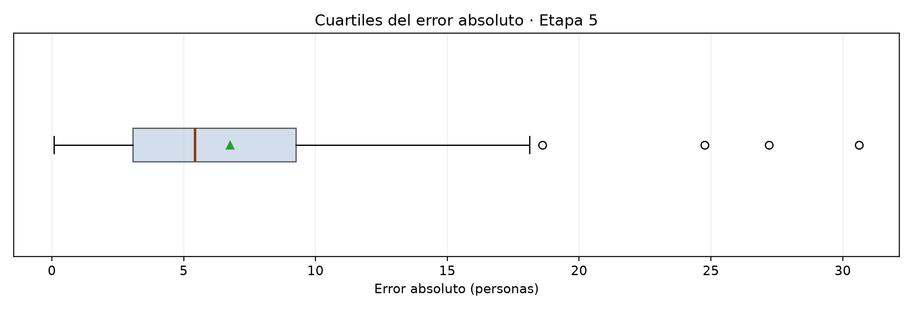

# PokePonche Predict 🎯

**Predicción de asistencia a quedadas de Pokémon GO mediante CatBoost, registros de participación y un contador de interesados (RSVP).**



> **Resultado principal:** **MAE de 6.75 personas por quedada** en **81 eventos de prueba**, utilizando el contador retrospectivamente reconstruido de participantes interesados. La mediana del error absoluto fue **5.43 personas**. Estos resultados NO representan una validación prospectiva con capturas reales del contador al inicio.

## 1. Objetivo

Predecir la cantidad de usuarios que registrarán un `CHECKED_IN` en una quedada de **Pokeponche de Frutas [Puebla]**, para apoyar la planificación de actividades y recursos. El problema es de **regresión supervisada**, con objetivo numérico `checkins` por evento. Las fechas abarcan noviembre de 2023 a noviembre de 2026.

## 2. Datos: qué se entrenó realmente

| Concepto | Magnitud | Función |
|---|---:|---|
| Quedadas | **548** | **548 observaciones del modelo**; cada fila es un evento |
| Registros individuales | **33,848** | Historial de interacción de usuarios para calcular características agregadas |
| Usuarios distintos | **5,131** | Historial seudonimizado; se preserva la recurrencia sin revelar IDs originales |
| Check-ins | **23,032** | Suma del objetivo entre las quedadas |
| Eventos del test final | **81** | Evaluación cronológica reservada |

**Importante:** no entrenamos un modelo con 33,848 ejemplos independientes de asistencia. El modelo final **aprende sobre las 548 quedadas**; las 33,848 filas individuales se usan para obtener, antes de cada fecha, variables de actividad, retención y asistencia recurrente, y para reconstruir el contador RSVP. Confundir estos conceptos inflaría artificialmente la descripción del tamaño de entrenamiento.

### Reconstrucción de “Voy a asistir”

En el histórico, cada pareja usuario/evento tiene un estado final. El contador se aproxima como:

```text
interesados_total_proxy = número de ACCEPTED + número de CHECKED_IN
checkin_rate = CHECKED_IN / interesados_total_proxy
```

Por ejemplo, **32 check-ins + 18 `ACCEPTED` restantes = 50 interesados**, y la conversión fue **64 %**.

**Advertencia metodológica:** el CSV exportado no aporta la hora del RSVP ni una instantánea al inicio. El contador reconstruido es un **proxy retrospectivo**, que contiene información de estados finales y está vinculado con el objetivo. La precisión reportada es válida para esta evaluación retrospectiva y **no debe describirse como exactitud ya comprobada antes del evento**. Para uso real, hay que registrar el número visible de interesados en el momento concreto en el que se desea predecir y validar frente al check-in posterior.

## 3. Metodología

1. **Integración:** conciliación por `event_id` entre el maestro de 548 eventos y los registros individuales; validación de 23,032 check-ins sin duplicados por usuario/evento.
2. **Características de calendario y evento:** día de la semana, estacionalidad, tipo de evento y distinción entre evento global principal y preparatorio.
3. **Historial sin mirar hacia adelante:** medias/medianas móviles, últimos eventos del mismo tipo, usuarios activos 30/90/180 días, retención y conversión histórica; solo se usan eventos de días anteriores para estas variables.
4. **RSVP:** reconstrucción de interesados `CHECKED_IN + ACCEPTED` por quedada para la evaluación de la Etapa 5.
5. **División temporal:** entrenamiento, validación y prueba por fechas ordenadas, sin repartir eventos de un mismo día entre splits; **81 quedadas** quedan reservadas para prueba final.
6. **Optimización:** **20 trials de Optuna (TPE, semilla 42)** en CatBoost; tres ventanas de validación temporal para escoger hiperparámetros y estrategia.
7. **Modelo final:** **CatBoost de conversión**, que estima una proporción de interesados que se convertirán en check-ins. Gana por validación, no por escoger retrospectivamente el test.

### Modelos y técnicas evaluadas a lo largo del proyecto

| Experimento | Técnicas | Qué aprendimos |
|---|---|---|
| Etapa 1 — línea base | Medianas históricas, Random Forest y Gradient Boosting | Establecer una referencia temporal y entender la estacionalidad |
| Etapa 2 — alternativas | Gradient Boosting, CatBoost, MLP en PyTorch | CatBoost funcionó mejor en el escenario anticipado; separar globales de eventos normales es importante |
| Etapa 3 — búsqueda | Optuna, CatBoost con ponderación, transformación `log1p`, ajuste global | El mejor anticipado redujo MAE hasta ~16.78 |
| Etapa 4 — actividad | Variables de usuarios únicos, recurrencia, historial de check-ins y RSVP experimental | Las variables individuales enriquecen el nivel de evento; el proxy RSVP es una señal más fuerte |
| Etapa 5 — final | Conversión histórica suavizada, CatBoost directo, objetivo logarítmico y **CatBoost de conversión** | El ganador con proxy RSVP alcanzó **MAE 6.75** |
| Etapa 6 — calibración (descartada) | Corrector especializado por cantidad de interesados | No mejoró MAE general (~6.76); se conservó Etapa 5 |

En el repositorio publicamos **el pipeline final y los módulos de preparación de los que depende**, no todos los modelos descartados. La tabla documenta los experimentos anteriores sin convertir el repositorio en un archivo de versiones.

## 4. Interfaz del modelo: entradas, salida y arquitectura

### 4.1 ¿Qué necesita para hacer una predicción?

El predictor calcula el número esperado de check-ins **para un evento completo** (no predice una clase por usuario). Requiere tres bloques:

| Bloque | Ejemplos | Procedencia / disponibilidad |
|---|---|---|
| **Evento y fecha** | `fecha_puebla`, `tipo_campfire`, `nombre_campfire`, fase global o preparatoria, características de bonos y Pokémon | Calendario y descripción del evento, antes de la predicción |
| **Histórico de la comunidad** | Asistencia de las últimas 5/10 quedadas, últimos eventos del mismo tipo, participantes activos en 30/90/180 días, retención y conversión anterior | Calculado desde eventos y usuarios **anteriores a la fecha objetivo** |
| **Contador de interesados** | Total de personas que marcaron «Voy a asistir» en Campfire | En el experimento histórico: `interesados_total_proxy = ACCEPTED + CHECKED_IN`. En operación: contador **observado en el momento** de la predicción |

La fecha y el contador, **por sí solos, no bastan** para reproducir el resultado: también hace falta el histórico para calcular el vector de variables de cada evento. Los identificadores y nicknames no se suministran al modelo como variables predictivas: únicamente se usan para contar usuarios distintos y reconstruir actividad histórica.

**Salida:** una estimación numérica no negativa de `checkins` para la quedada. Se puede redondear al entero más cercano al presentarla; las métricas del test se calcularon con predicciones continuas.

### 4.2 Arquitectura exacta de la versión seleccionada

El archivo `models/modelo_catboost.cbm` corresponde a un **`CatBoostRegressor`** basado en *gradient boosting* de árboles de decisión. **No es una red neuronal** ni un clasificador usuario-a-usuario.

| Componente | Configuración del modelo final |
|---|---|
| Tipo | Regresión con CatBoost, árboles simétricos (*oblivious trees*) |
| Número de árboles (`iterations`) | **400** |
| Profundidad (`depth`) | **3** (hasta 8 hojas por árbol) |
| Tasa de aprendizaje (`learning_rate`) | **0.0337569126** |
| Regularización L2 (`l2_leaf_reg`) | **4.6493457** |
| Función de pérdida (`loss_function`) | **MAE** |
| Semilla (`random_seed`) | **42** |
| Variables que recibe el modelo guardado | **46**: 41 numéricas y 5 categóricas |
| Búsqueda de hiperparámetros | **20 trials de Optuna**, con TPE y validación temporal |

**Objetivo aprendido:** el modelo ganador (`conversion`) no ajusta directamente el número de asistentes. Durante el entrenamiento utiliza:

```text
conversion_observada = checkins_reales / max(interesados_total_proxy, 1)
```

En la predicción produce una tasa estimada que se recorta al intervalo `[0, 1]` y luego se convierte a personas:

```text
tasa_estimada = clip(modelo_catboost.predict(X_evento), 0, 1)
checkins_estimados = max(0, tasa_estimada * interesados_observados)
```

**Detalle de implementación:** `interesados_total_proxy` se extrae de la matriz `X` antes de llamar a `fit()` y a `predict()` en esta variante. Por eso **no aparece dentro de las 46 características almacenadas en el `.cbm`**, pero sí es un **parámetro imprescindible del predictor completo**, ya que multiplica la conversión estimada. El script `scripts/verificar_modelo.py` reproduce este mismo posprocesado.

### 4.3 Las 46 variables utilizadas realmente

Las variables se calculan en `train_etapa2.py`, `train_etapa4_mejorada.py`, `train_etapa5.py` y `train_etapa5_rsvp.py`, antes de entregar la matriz a CatBoost.

| Grupo | Entradas |
|---|---|
| Calendario (9) | `is_weekend`, `year_offset`, `month`, `day_of_week`, `week_of_year`, `is_holiday_season`, `event_sequence`, `days_since_first_event`, `days_since_previous_event` |
| Eventos globales y contexto (3) | `is_global_major_event`, `is_global_pre_event`, `days_until_main_event` |
| Historial agregado de quedadas (8) | `prior_events_same_type`, `hist_last_5_mean`, `hist_last_10_mean`, `hist_last_10_median`, `hist_same_type_last_5_mean`, `hist_same_type_last_5_median`, `days_since_previous_same_type`, `prev_event_checkins` |
| Atributos del evento y sus Pokémon (9) | `has_paid_bonus_evidence`, `has_free_bonus_evidence`, `has_assumed_free_bonus`, `has_exclusive_move_section`, `has_shiny_boost_evidence`, `has_pokemon_debut_evidence`, `has_paid_research_evidence`, `pokemon_label_missing`, `primary_pokemon_count` |
| Actividad de usuarios (11) | `user_active_30d`, `user_active_90d`, `user_active_180d`, `user_checkins_30d`, `user_checkins_90d`, `user_retention_90d`, `users_with_3plus_prior_checkins`, `community_users_seen_prior`, `prior_conversion_10`, `prior_conversion_same_type`, `recent_accepted_mean_5` |
| Conversión histórica adicional (1) | `conversion_historica_anterior` (suavizada hacia la tasa global reciente cuando existen pocos casos del mismo tipo) |
| Variables categóricas (5) | `tipo_campfire`, `event_phase`, `event_family`, `major_event_subtype`, `month_label` |

En total: **41 numéricas + 5 categóricas = 46**. Las variables categóricas se procesan nativamente con CatBoost; no se aplicó *one-hot encoding* externo al modelo final. Las numéricas ausentes se codifican como `-99999` y las categóricas ausentes como `desconocido` en la matriz final. El orden de las 46 variables es el que espera el `.cbm`; no debe cambiarse en inferencia.

### 4.4 Transformaciones y decisiones necesarias

1. **Normalización de eventos:** unión por `event_id`, comprobación de que cada evento tenga una sola fila, validación de check-ins y del estado RSVP sin duplicar personas.
2. **Corrección de preparatorios:** las quedadas del **9 y 10 de noviembre de 2026** se etiquetan en el entrenamiento como `wild_area_pre_event` y `pre_event`, en vez de mezclar su asistencia con la de un evento global principal. El CSV maestro conservado no se modifica en disco.
3. **Ingeniería de variables secuencial:** medias/medianas de eventos anteriores, actividad de usuarios por ventanas de 30/90/180 días y tasas de conversión. En un mismo día, las estadísticas se calculan antes de incorporar los resultados de las quedadas de esa fecha.
4. **Reconstrucción del RSVP:** `ACCEPTED + CHECKED_IN` por `event_id`; el conteo final del histórico se distingue expresamente del contador que podría observarse al inicio.
5. **Regresión de conversión:** se aprende una tasa entre cero y uno y se transforma a check-ins multiplicándola por los interesados; las predicciones no negativas son la salida final.
6. **Separación temporal y selección de modelos:** entrenamiento y validación previos al período final de 81 quedadas; Optuna prueba 20 combinaciones para CatBoost directo y después se comparan conversión histórica, predicción directa, transformación `log1p` y conversión con CatBoost.
7. **Evaluación y publicación:** se reportan métricas calculadas sobre el conjunto temporal de prueba, se conserva el modelo original `.cbm` y se sustituyen identificadores y nicknames de participantes antes de preparar la copia pública.

El código incluye componentes usados originalmente en experimentos anteriores, pero el modelo publicado usa **solo** la matriz del escenario `anticipado` **más** `conversion_historica_anterior`, y **no** las variables meteorológicas o rankings competitivos retrospectivos.

### 4.5 Limitación de la evaluación con RSVP

La evaluación de 6.75 personas utiliza el contador `ACCEPTED + CHECKED_IN` **reconstruido del CSV final**. El propio contador contiene un componente igual al resultado (`CHECKED_IN`), por lo que existe **dependencia del objetivo en la variable operacional reconstruida**. Esto es adecuado para explorar una posible relación RSVP/asistencia, pero **no demuestra** que se consiga el mismo MAE al comienzo de nuevos eventos. Para validar la versión operativa, se necesita guardar el contador visible real al inicio y comparar después con la asistencia final.

## 5. Evaluación

**Período de prueba: 29/07/2026–10/11/2026; 81 quedadas.**

| Métrica | Resultado |
|---|---:|
| MAE (error absoluto medio) | **6.75 personas** |
| Mediana del error absoluto (Q2) | **5.43 personas** |
| Primer cuartil (Q1) | 3.07 personas |
| Tercer cuartil (Q3) | 9.26 personas |
| Percentil 90 del error absoluto | 13.80 personas |
| RMSE | 8.98 personas |
| WAPE | 13.65 % |
| R² | 0.972 |
| Sesgo medio (predicho − real) | −0.08 personas |

Interpretación: en el conjunto de prueba, **la mitad de los errores absolutos fue ≤5.43 personas** y **el 75 % fue ≤9.26**. Un MAE de 6.75 representa el promedio de magnitudes de los errores, no una garantía en cada evento. El R² alto también puede estar influido por unos pocos eventos de gran asistencia.

### Tendencia temporal (visualización principal)


Se muestran las 81 quedadas de prueba en orden temporal, sin agregar por mes ni ocultar eventos grandes.

### Dispersión: reales vs predichos



La diagonal corresponde al valor ideal de una predicción exacta.

### Distribución del error absoluto



Los cuartiles resumen la dispersión de los errores en personas, independientemente del volumen del evento.

## 6. Cómo reproducir el entrenamiento

Python 3.11–3.13, Windows PowerShell (también compatible con otras plataformas).

```powershell
python -m venv .venv
.\.venv\Scripts\python.exe -m pip install -r requirements.txt
.\.venv\Scripts\python.exe scripts\verificar_datos.py
.\.venv\Scripts\python.exe scripts\train_etapa5_rsvp.py --root . --trials 20
```

El script carga los CSV seudonimizados en `data/`, reconstruye las variables de fecha y comportamiento, entrena los candidatos, usa validación temporal y crea `resultados_etapa5_rsvp/`. Los hiperparámetros probados y las salidas publicadas están en `results/`. **Reentrenar puede generar ligeras diferencias por versiones de bibliotecas o concurrencia**; por eso se incluye el modelo `.cbm` ganador original y las predicciones históricas.

Para comprobar el modelo guardado:

```powershell
.\.venv\Scripts\python.exe scripts\verificar_modelo.py
```

Para reconstruir los tres gráficos a partir de las predicciones publicadas:

```powershell
.\.venv\Scripts\python.exe scripts\generar_graficos.py
```

## 7. Estructura

```text
PokePonche_Predict_GitHub/
├── README.md
├── LICENSE
├── requirements.txt
├── .gitignore
├── data/
│   ├── dataset_maestro_548.csv
│   └── registros_usuarios_pseudonimizados.csv
├── scripts/
│   ├── train_etapa5_rsvp.py        # Pipeline final
│   ├── train_etapa5.py             # Construcción de variables
│   ├── train_etapa4_mejorada.py    # Historial por usuario
│   ├── train_etapa3.py             # CV temporal
│   ├── train_etapa2.py             # Calendario e históricos
│   ├── fases_eventos.py            # Clasificación de preparatorios
│   ├── verificar_datos.py
│   ├── verificar_modelo.py
│   └── generar_graficos.py
├── models/
│   └── modelo_catboost.cbm        # Pesos del ganador de 20 trials
├── results/
│   ├── predicciones_test.csv
│   ├── metricas_test.csv
│   ├── validacion_temporal.csv
│   ├── seleccion_modelo.csv
│   ├── optuna_trials.csv
│   └── reporte.json
└── assets/
    ├── 01_tendencia_real_vs_prediccion.png
    ├── 02_dispersion_real_vs_prediccion.png
    └── 04_boxplot_error.png
```

## 8. Privacidad y publicación

Se publican **datos minimizados y seudonimizados**: `USUARIO1`, `USUARIO2`, etc. sustituyen simultáneamente el ID interno y el nickname de cada persona. Los identificadores reales de quedadas se sustituyen por `EVT0001`, etc. Se eliminaron perfiles, URL de evento, IDs de organizadores y otros campos originales que no son necesarios para reproducir el pipeline. La correspondencia original↔seudónimo **no se distribuye**.

**Seudonimizar no es anonimizar:** la secuencia de fechas, tipos de eventos y asistencia individual aún podría permitir reidentificar a usuarios activos con fuentes públicas. Si no cuentas con autorización para divulgar registros individuales, **no publiques `data/registros_usuarios_pseudonimizados.csv`**: conserva ese fichero local e indica que los datos de entrenamiento están restringidos; los resultados, métricas, gráficos y código pueden publicarse por separado. Revisa también los títulos de eventos públicos antes de hacer el primer push.

## 9. Limitaciones y próximos pasos

- El test está compuesto por eventos de la misma comunidad; no se ha demostrado generalización a otras ciudades o clubes.
- Los registros de Campfire exportados pueden perder participaciones históricas cuando usuarios dejan el grupo.
- El proxy de interesados no es un snapshot con hora verificada: la evaluación es retrospectiva y requiere validación al inicio de nuevas quedadas.
- El modelo no predice eventos nuevos únicamente a partir de su fecha: necesita variables históricas y el contador de interesados.
- El R² alto no implica un porcentaje de acierto del 97.2 %.

## Tecnologías

`Python` · `pandas` · `NumPy` · `CatBoost` · `Optuna` · `scikit-learn` · `Matplotlib` · `PyTorch` (explorado en Etapa 2)

## Autoría y uso

Proyecto independiente de análisis de asistencia comunitaria. Los nombres Pokémon, Campfire y las marcas relacionadas pertenecen a sus respectivos titulares. Los datos individuales seudonimizados se proporcionan solo si su publicación está autorizada.
